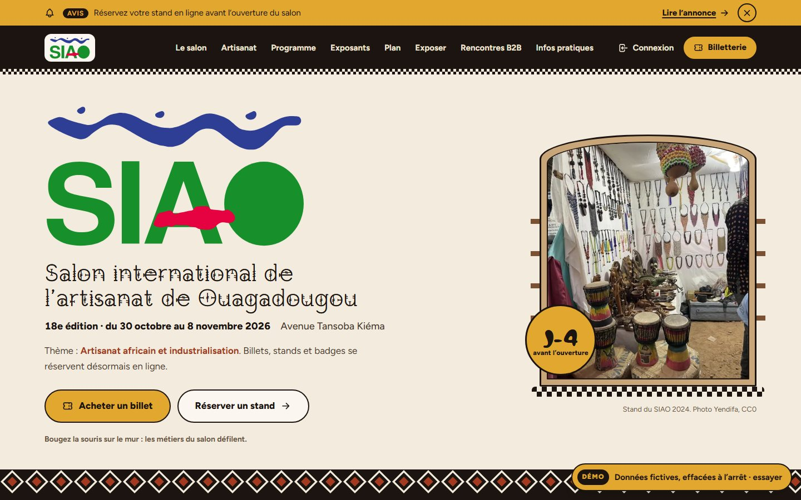

## Alex COMPAORE

Passionné du numérique, j’explore, j’apprends et je crée des solutions qui donnent vie aux idées.
Ouagadougou, Burkina Faso.

### SIAO 2026 · site du salon, billetterie et e-SIAO

Un site complet pour le Salon international de l’artisanat de Ouagadougou :

- **vitrine** : le salon, l’artisanat burkinabè, le programme, les exposants, le plan, les infos pratiques ;
- **billetterie** en ligne, paiement Orange Money et Moov Money, billets dont le QR code change toutes les 15 secondes, transfert de billet ;
- **e-SIAO** : réservation et paiement des stands, badges, rendez-vous d’affaires entre exposants et acheteurs ;
- **back-office** par service (direction, commercial, billetterie, communication), contrôle des entrées, publication sur les réseaux sociaux, double authentification.

La démo s’ouvre dans le navigateur, sans rien installer. Les identifiants pour tester les espaces et le back-office sont dans le bandeau « Démo », en bas à droite. Les données sont fictives, les paiements simulés ne valident aucune commande, aucun e-mail n’est envoyé, et tout est effacé quand la démo se met en veille. Si personne ne l’a ouverte récemment, le premier chargement prend une à deux minutes.

**Technique** : Laravel 12, PHP 8.2, MySQL, animations GSAP et WebGL. Tests automatisés et analyse de sécurité (Semgrep) à chaque modification.

Projet personnel, non affilié à l’organisation du salon. Code source privé, sous licence propriétaire.

Photo de la capture : stand du SIAO 2024, par Yendifa, domaine public ([CC0](https://creativecommons.org/publicdomain/zero/1.0/)), via [Wikimedia Commons](https://commons.wikimedia.org/wiki/File:SIAO_2024.jpg).

### Maison du Peuple · site web et billetterie en ligne

Un site complet pour la salle de spectacle de la Maison du Peuple, à Ouagadougou :

- **vitrine** : programmation, artistes, jeunesse, communauté, actualités, location de la salle, contact ;
- **billetterie** en ligne, paiement par Mobile Money et billets avec QR code ;
- **espaces personnels** pour les spectateurs et pour les artistes ;
- **back-office** de gestion, avec double authentification.

La démo s’ouvre dans le navigateur, sans rien installer. Les identifiants pour tester les espaces et le back-office sont dans le bandeau « Démo », en bas à droite. Les données sont fictives, les paiements simulés, aucun e-mail n’est envoyé, et tout est effacé quand la démo se met en veille. Si personne ne l’a ouverte récemment, le premier chargement prend une à deux minutes.

**Technique** : Laravel 12, PHP 8.2, MySQL, animations GSAP. Tests automatisés et analyse de sécurité (Semgrep) à chaque modification.

Code source privé, sous licence propriétaire.

Photo de fond de la capture : « Grand concert Rema 2023 », par La Cour du Naaba, [CC BY-SA 4.0](https://creativecommons.org/licenses/by-sa/4.0/), via [Wikimedia Commons](https://commons.wikimedia.org/wiki/File:Grand_concert_Rema_2023_19.jpg), recadrée.
